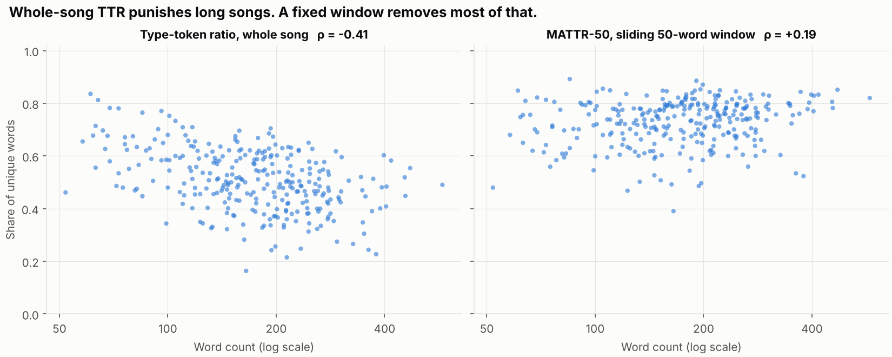
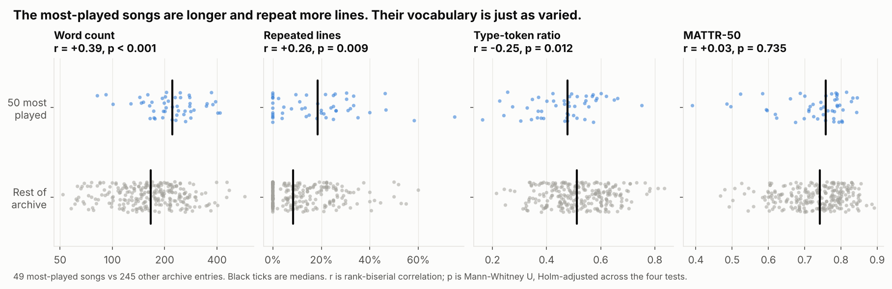
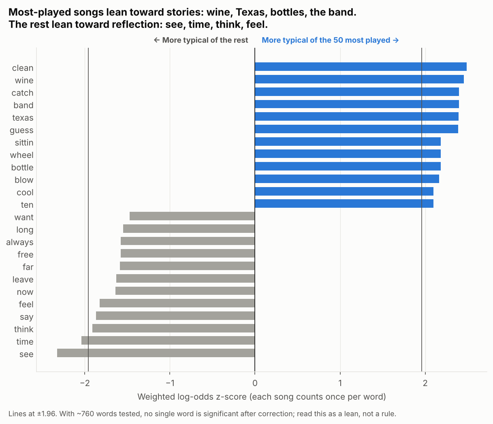
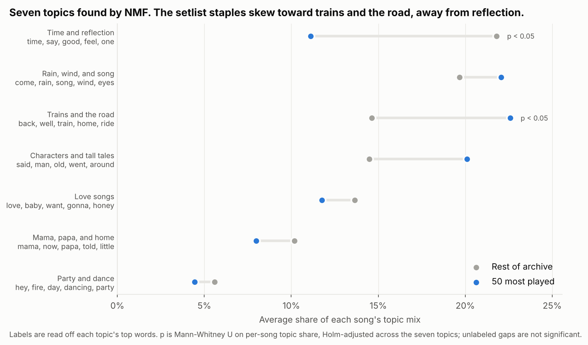

# Grateful Dead Lyrics: Complexity vs. Popularity

[](https://github.com/JacobWillson13/grateful-dead-lyric-analysis/actions/workflows/checks.yml)

Are the songs the Grateful Dead played most lyrically simpler than the rest? This repo measures 309
lyric transcriptions and compares the band's 50 most-played songs against everything else.

**Short answer:** no. The most-played songs look simpler on a naive measure, but only because they are
longer and repeat more lines. Measured properly, their vocabulary is just as varied. What does differ
is subject matter: the setlist staples are about trains, the road, and characters, not reflection.

## 1. The naive metric is biased by length



Type-token ratio (unique words / total words) drops as songs get longer, because every extra line has
more chances to reuse a word (Spearman ρ = −0.41). The moving-average type-token ratio (MATTR) averages
over every 50-word window instead, which takes most of the length effect out (ρ = +0.19).

## 2. Most played vs. the rest



| | 50 most played | Rest | Effect (rank-biserial) | p (Holm) |
| --- | --- | --- | --- | --- |
| Median word count | 222 | 166 | +0.39 | < 0.001 |
| Median repeated lines | 19% | 8% | +0.26 | 0.009 |
| Median type-token ratio | 0.48 | 0.51 | −0.25 | 0.012 |
| Median MATTR-50 | 0.76 | 0.74 | +0.03 | 0.73 |

On type-token ratio alone you would conclude the popular songs are lyrically simpler. That conclusion
disappears once the metric accounts for length.

## 3. Which words set them apart



Weighted log-odds with an informative Dirichlet prior (Monroe et al., 2008), computed on song-level word
presence so a repeated chorus counts once. The most-played side reads like country and western storytelling:
*Texas* shows up in El Paso, Me and My Uncle, Jack Straw, and Minglewood Blues. The other side is
introspective: *see, time, think, feel*. No single word survives correction for ~760 comparisons, so
treat this as a lean, not a rule.

## 4. Topics



NMF on TF-IDF finds seven topics. Each topic keeps at least 83% of its top words across ten random
seeds (k = 8 left one topic at 40%, so it was dropped). Two differences survive correction. Trains and
the road make up 23% of a typical setlist staple vs. 15% for the rest of the archive. Time and reflection
make up 11% vs. 22%.

## Data

- **Lyrics:** the [CMU Grateful Dead lyrics archive](https://www.cs.cmu.edu/~mleone/dead-lyrics.html), 309 transcriptions
  including covers and some Jerry Garcia Band material. Lyrics are **not** committed. `scripts/fetch_corpus.py` caches
  them locally with a SHA-256 per file. `scripts/build_features.py` checks those hashes and writes only metrics and
  per-song word counts (`data/processed/`).
- **Popularity:** times played live, from [setlist.fm](https://www.setlist.fm/stats/grateful-dead-bd6ad4a.html)
  (2,337 setlists, retrieved October 2026) in `data/setlistfm_play_counts.csv`. Instrumentals (Drums, Space, Jam,
  Feedback, Slipknot!) are excluded before ranking. All 50 of the top 50 match a lyric entry, 6 of them through an
  explicit alias in `data/title_aliases.csv`. There is no fuzzy matching.
- **Sample:** comparisons use the 294 entries with at least 50 words and no editorial notes in the transcription,
  which drops Little Red Rooster and leaves 49 of the top 50.

## Methods

| Measure | Definition |
| --- | --- |
| Tokens | Unicode letters, lowercased, apostrophes kept inside contractions. No stemming. |
| Type-token ratio | Unique tokens / total tokens |
| MATTR-50 | Mean type-token ratio across every 50-token window ([Covington and McFall, 2010](https://doi.org/10.1080/09296171003643098)) |
| Repeated lines | Share of lines that exactly repeat an earlier line |
| Group tests | Mann-Whitney U with rank-biserial effect size, Holm-adjusted |
| Distinctive words | Weighted log-odds z-score, prior strength 200, words in 5+ songs, function words removed |
| Topics | scikit-learn NMF on sublinear TF-IDF, k = 7, NNDSVD init, words in at least 5 songs and at most 40% of them |

## Run it

```bash
pip install -r requirements.txt
python -m unittest discover -s tests
python scripts/build_analysis.py          # rebuilds results/ and figures/ offline
```

To rebuild from the source archive: `python scripts/fetch_corpus.py && python scripts/build_features.py`.
CI reruns the tests and the analysis on Python 3.11 and 3.12 and fails if any file in `results/` changes.

## Caveats

Live play counts measure what the band chose to play, not what audiences liked best. setlist.fm is
crowd-sourced. Transcription habits ("repeat chorus" vs. written out) affect every lyric metric. These are
descriptive comparisons, not causal claims.

## Sources

- [CMU Grateful Dead lyrics archive](https://www.cs.cmu.edu/~mleone/dead-lyrics.html)
- [setlist.fm: Grateful Dead song statistics](https://www.setlist.fm/stats/grateful-dead-bd6ad4a.html)
- Covington and McFall (2010), [Cutting the Gordian Knot: The Moving-Average Type-Token Ratio](https://doi.org/10.1080/09296171003643098)
- Monroe, Colaresi, and Quinn (2008), [Fightin' Words: Lexical Feature Selection and Evaluation for Identifying the Content of Political Conflict](https://doi.org/10.1093/pan/mpn018)
